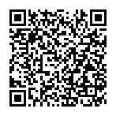

# Public Web3 identity

The owner has approved associating the following wallet address with the ShivanshOS public identity:

`0x4fd036ece52c4b0746da71ecf8be38c94d435164`

**Verification:** owner-declared, cryptographic proof pending. No token balances, NFTs, developer credentials or transaction histories have been validated.

[Original Gravity Alpha explorer](https://explorer.gravity.xyz/address/0x4fd036ece52c4b0746da71ecf8be38c94d435164?tab=index)

The QR code opens the original explorer reference, not a payment request.

<Warning>Gravity Alpha Mainnet (chain ID 1625) was scheduled for deprecation on November 1, 2026. The newer Gravity L1 Mainnet uses chain ID 127001. This historical explorer reference is not proof of asset migration. Read [Galxe's official migration guidance](https://help.galxe.com/en/articles/16010489-gravity-l1-mainnet-is-now-live).</Warning>

[Current Gravity L1 explorer lookup](https://mainnet-explorer.gravity.xyz/address/0x4fd036ece52c4b0746da71ecf8be38c94d435164)

## Privacy and evidence

Publishing a wallet can expose related public blockchain activity. A future proof can use an expiring, domain-specific message signature. Do not share private keys, recovery phrases or token approvals.
